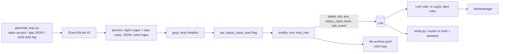

# log-pipeline-lab: Fluent Bit → Loki with parsing, enrichment and LogQL alert rules

> **Lab project.** The logs are synthetic and seeded (`gen/generate_logs.py`), with three injected incidents and a `truth.json` of expected counts. Everything below ran on real Fluent Bit 5.1.3 and Loki 3.2.0 binaries on my lab machine.

## Problem
Raw logs in files aren't observability. You need **structured fields** (status, latency, src_ip), **low-cardinality labels** so Loki stays cheap, **noise dropped at the edge** (LB health checks), and **alerts on log patterns** (5xx ratio, SSH brute force, slow requests). You also need proof that the pipeline doesn't silently lose or mis-parse lines. Here every count in Loki is compared against the generator's ground truth.

## Architecture


## Run
```bash
# needs fluent-bit (packages.fluentbit.io) and loki (GitHub release) on PATH
pip install -r requirements.txt
PATH=/opt/fluent-bit/bin:$PATH pytest -q          # real Fluent Bit parse/filter test
PATH=/opt/fluent-bit/bin:$PATH scripts/run_lab.sh # full pipeline + verification
docker compose up --build                          # loggen + loki + fluent-bit + grafana
```

## Results (actual run, 2026-10-11)
**Ingestion vs ground truth** (`results/lab_run.log`): all 5 checks match exactly.

| Check | Loki | Truth |
|---|---|---|
| nginx lines after dropping /healthz | 1659 | 1659 (2000 − 341 healthz) |
| nginx 5xx (via Lua `status_class` label) | 65 | 65 |
| sshd failed passwords from 203.0.113.50 | 19 | 19 |
| app `level=error` | 65 | 65 |
| slow requests > 1 s (`| json | request_time > 1`) | 36 | 36 |

Fluent Bit output metrics: 3859 records to Loki, **0 errors, 0 retries, 0 dropped** (`results/fluentbit_metrics.json`). The Loki ruler loaded all 4 rules (`results/loki_rules.json`).

**Alert backtest.** Each rule is evaluated with its real 5m window at every minute of the 10-minute log span (`#` means the condition is true):
```
Nginx5xxRateHigh   T-10 ........### T-0     (8.3% 5xx at end; threshold 5%)
SSHBruteForce      T-10 ...#####... T-0     (19 fails from 203.0.113.50 > 10)
SlowRequests       T-10 .....#####. T-0
AppErrorSpike      T-10 ........### T-0     (products 24, search 21)
```
Each rule fires only while its incident is inside the window, and no rule fires during the clean first 3 minutes.

**Iteration that mattered:** my first generator put 5xx only on `/api/checkout`. Over 5 minutes that's about 1% errors, so the 5% ratio alert never fired. That was a realistic lesson in ratio alerts diluting single-route outages. I changed the incident to a DB outage affecting all API routes. A per-route ratio rule would be the production fix.

`pytest`: **2 passed**. One test runs the real Fluent Bit binary and asserts that healthz is dropped, status is cast to int, the 5xx class is right, and sshd fields are extracted.

**Not run:** Docker Compose and Grafana (Docker not run yet). I did not test with Alertmanager receiving the ruler's notifications. Rules were verified as loaded and as instant/backtest queries.

## Limitations
- Static files, not live rotation. Tail with a `DB` file handles restarts, but I didn't test logrotate `copytruncate`.
- The sshd regex covers 4 message types. Real auth.log has many more (PAM, `Connection closed by authenticating user`, etc.).
- Syslog lines have no year or timezone, so Fluent Bit assumes the current year in local time. Prefer RFC 5424 or journald input.
- Single-binary Loki on a filesystem isn't HA. Production would use object storage plus a microservices or simple-scalable deployment.
- I chose Loki over Elastic for cost (index labels only). Full-text search over high-volume logs is slower.

## Sources
- Fluent Bit tail, parsers, grep, lua, loki output: https://docs.fluentbit.io/manual/
- Loki label best practices (cardinality): https://grafana.com/docs/loki/latest/get-started/labels/bp-labels/
- LogQL metric queries and alerting rules: https://grafana.com/docs/loki/latest/alert/
- MITRE ATT&CK T1110.001: https://attack.mitre.org/techniques/T1110/001/
